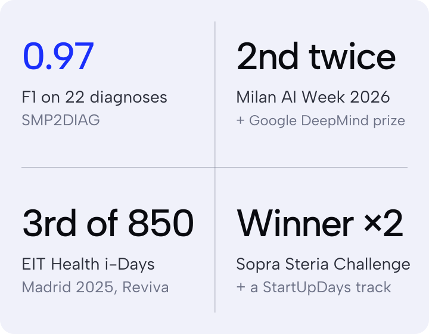

<a href="https://akirykouski.space">
  <picture>
    <source media="(prefers-color-scheme: dark)" srcset="./assets/hero-dark.svg">
    
  </picture>
</a>

  <a href="https://akirykouski.space"><b>akirykouski.space</b></a> ·
  <a href="https://www.linkedin.com/in/kirykouski-arseniy">LinkedIn</a> ·
  <a href="mailto:akirikowski@gmail.com">Email</a> ·
  <a href="https://akirykouski.space/cv.pdf">CV</a>

At **[Veliu](https://akirykouski.space/#experience)**, an agentic commerce lab, I build production LLM and agent systems, the evals that check them, and the TypeScript and Python that ship them. Final-year BSc in Artificial Intelligence across Pavia, Milano Statale and Milano-Bicocca.

### Selected work

**[Live Context Collision](https://akirykouski.space/projects/live-context-collision)** · [code](https://github.com/akirykouski/live-context-collision)  
Real-time meeting agent. Five Gemini judges check each statement against company memory, and a deterministic verifier makes every warning quote its source verbatim. 2nd in two Vultr categories and a Google DeepMind prize at Milan AI Week 2026.

**[Clario](https://akirykouski.space/projects/clario)** · [code](https://github.com/akirykouski/symptom-diary)  
Local-first symptom diary. A fine-tuned Gemma extractor lifted entity F1 from 0.42 to 0.71. Encrypted at rest, no cloud, no telemetry.

**[SMP2DIAG](https://akirykouski.space/projects/smp2diag)** · [code](https://github.com/akirykouski/NLP_disease_prediction)  
22 diagnoses from symptom text. ClinicalBERT at 97% accuracy and F1 0.97, against PPMI, GloVe, Flan-T5 and a prompted LLM that reached 67%.

**[Reviva](https://akirykouski.space/projects/reviva)**  
Post-stroke rehab from a phone camera, with real-time movement feedback (OpenCV, PyTorch). Winner of the Sopra Steria International Student Challenge, 3rd of 850 at EIT Health i-Days Madrid 2025.

**[Bike demand](https://akirykouski.space/projects/bike-sharing)** · [code](https://github.com/akirykouski/Bikes_ML)  
Hourly London demand. Nested cross-validation picked a tuned Random Forest: RMSLE 0.30 on held-out data.

<picture>
  <source media="(prefers-color-scheme: dark)" srcset="./assets/proof-dark.svg">
  
</picture>

### Stack

**Models** PyTorch · Hugging Face · Gemini · Gemma · OpenCV · scikit-learn  
**Systems** TypeScript · Next.js · Python · FastAPI · PostgreSQL · Supabase · BullMQ  
**Shipping** Vultr · Vercel · Cloudflare Workers · GitHub Actions

Milan, Italy · English, Italian, Russian, Belarusian
